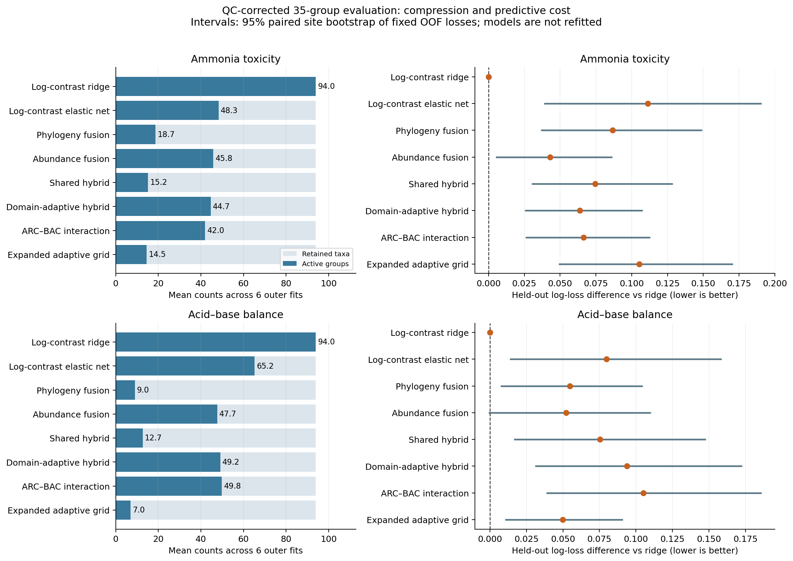
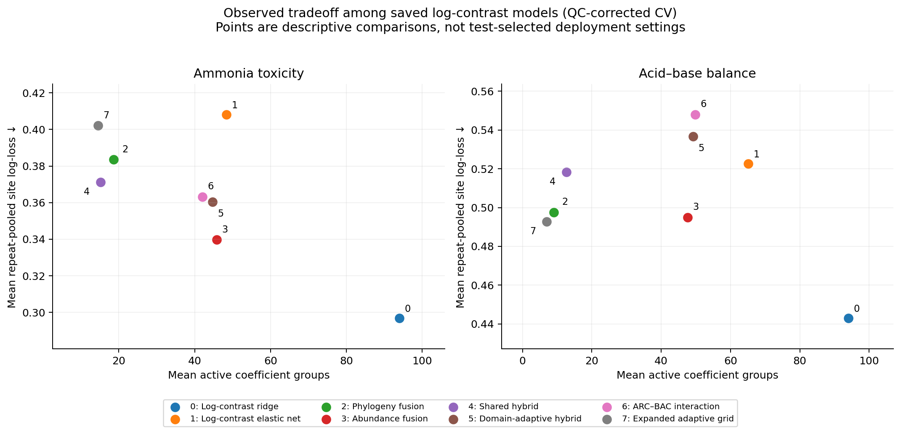
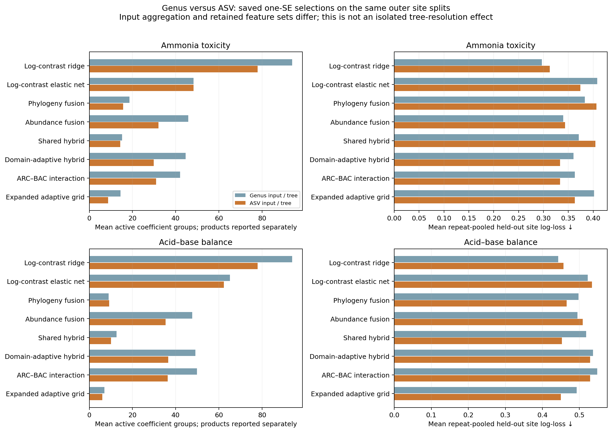
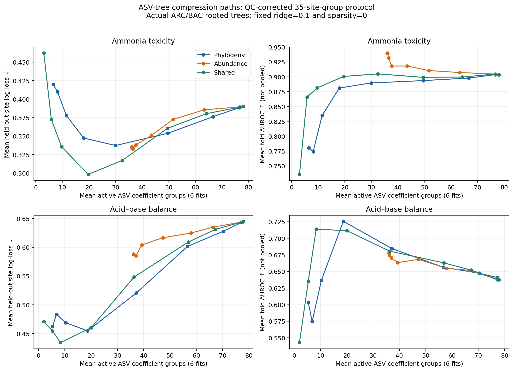
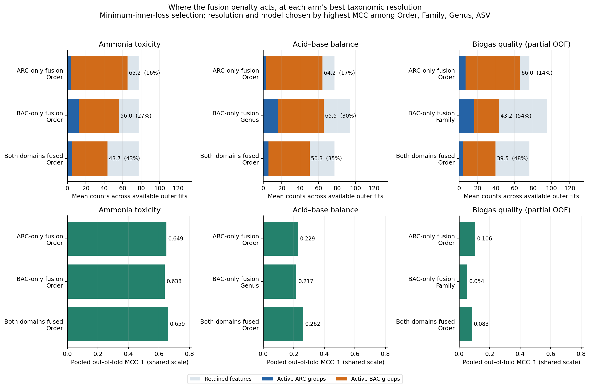
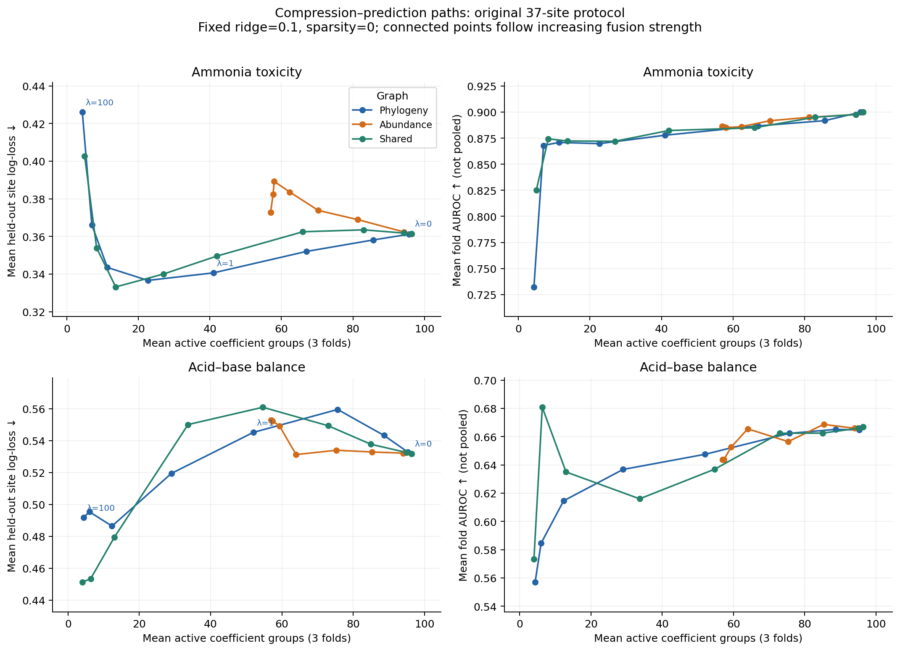
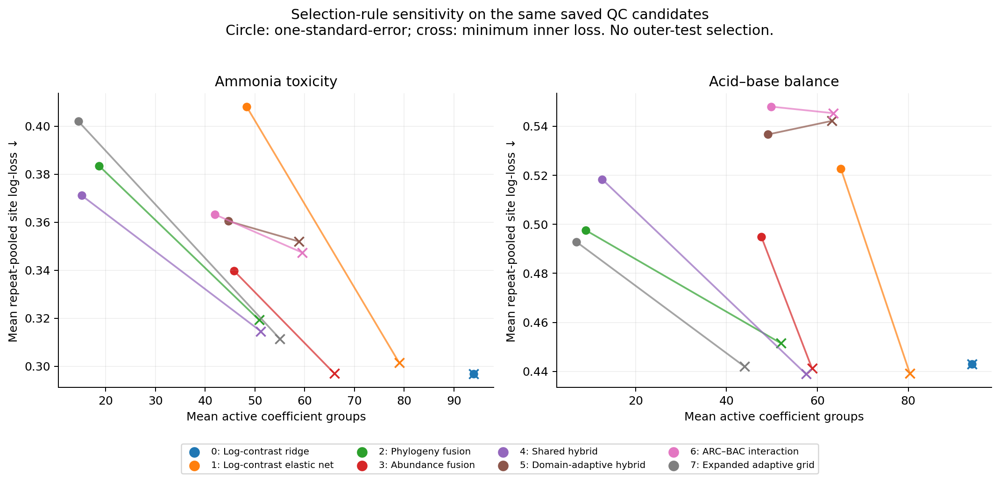

# Experiment 1 — prediction–compression tradeoff

This report combines reused genus-level fusionML outputs with a newly completed ASV-level fusionML run using the original ARC and BAC rooted trees. A third run adds the ARC-only/BAC-only/both-domain fusion arms for three warning flags. The report generator itself performs no fitting. Both resolutions use the existing fusionML estimator; these are not a new fusionMLv2 algorithm. No hyperparameters were selected using outer-test results.

## Domain-restricted fusion findings (three flags, best resolution per arm, minimum-inner-loss)

- **Ammonia toxicity:** arc-only fusion at order level keeps 65.2 of 77.2 retained features (15.7% reduction, MCC 0.649); bac-only fusion at order level keeps 56.0 of 77.2 retained features (27.5% reduction, MCC 0.638); both domains fused at order level keeps 43.7 of 77.2 retained features (42.8% reduction, MCC 0.659). Most compressed: both domains fused; highest MCC: both domains fused.
- **Acid–base balance:** arc-only fusion at order level keeps 64.2 of 77.2 retained features (17.0% reduction, MCC 0.229); bac-only fusion at genus level keeps 65.5 of 94.0 retained features (30.3% reduction, MCC 0.217); both domains fused at order level keeps 50.3 of 77.2 retained features (34.5% reduction, MCC 0.262). Most compressed: both domains fused; highest MCC: both domains fused.
- **Biogas quality:** arc-only fusion at order level keeps 66.0 of 76.2 retained features (13.5% reduction, MCC 0.106); bac-only fusion at family level keeps 43.2 of 95.2 retained features (54.2% reduction, MCC 0.054); both domains fused at order level keeps 39.5 of 76.2 retained features (48.2% reduction, MCC 0.083). Most compressed: bac-only fusion; highest MCC: arc-only fusion.

## New ASV findings

- **Ammonia toxicity:** 78.0 ASVs remain after filtering on average. Shared hybrid uses 14.3 active groups (81.5% additional reduction) with log-loss 0.404, versus ASV ridge 0.313. Adaptive hybrid uses 29.8 groups and has loss 0.333.
- **Acid–base balance:** 78.0 ASVs remain after filtering on average. Shared hybrid uses 10.0 active groups (86.9% additional reduction) with log-loss 0.453, versus ASV ridge 0.457. Adaptive hybrid uses 36.5 groups and has loss 0.529.

## Reused genus-level findings

- **Ammonia toxicity:** shared hybrid uses 15.2 active groups from 94.0 retained taxa (83.7% mean within-fold reduction), with log-loss 0.371 versus ridge 0.297. Adaptive hybrid uses 44.7 groups and has log-loss 0.360; abundance-only uses 45.8 groups and has log-loss 0.340.
- **Acid–base balance:** shared hybrid uses 12.7 active groups from 94.0 retained taxa (86.4% mean within-fold reduction), with log-loss 0.518 versus ridge 0.443. Adaptive hybrid uses 49.2 groups and has log-loss 0.537; abundance-only uses 47.7 groups and has log-loss 0.495.

Compression is present, but the hybrid models selected by the primary **one-SE rule** do not improve probability prediction over the tuned ridge reference in this QC-corrected comparison. Less aggressive compression under the saved minimum-loss rule gives different tradeoffs, including near-ridge loss for some acid–base models; those results are shown separately below. No noninferiority margin was prespecified, and fixed-prediction intervals do not include model-retraining uncertainty. See group counts and discrimination alongside loss rather than declaring a universal winner.

## Evaluation protocols and resolution

| Evidence | Protocol | Use |
| --- | --- | --- |
| Regularization paths | Original 37 site labels, 3 outer folds; two targets; phylogeny, abundance and 50:50 shared graphs; 9 fusion strengths; ridge=0.1 and sparsity=0 | Descriptive effect of stronger fusion; no inner tuning of this path |
| Domain-restricted fusion, order/family/genus/ASV | Same 35-group QC protocol, splits and seeds at every resolution; three flags; fusion edges given to ARC only, BAC only, or both domains; minimum-inner-loss selection ranked by MCC | Where the fusion penalty should act and at what resolution, not which domain to assay |
| Reused genus-level QC comparison | 134 samples, 35 groups; BSI/BSIb and DGY/DGYb kept together; 3 outer folds × 2 repeats; 2 inner folds; common splits and partition graph seeds | Primary comparison of saved selected models at full outer-training size |

The new ASV experiment also uses the 35-group QC protocol and the same cohort, labels and outer split assignments. Its full configuration and input hashes are recorded in a separate run manifest.

Only fraction=1.0 is used from the saved learning experiment. This means all available **outer-training sites**, not training on all 134 samples. The approximately 23 training groups per outer fit remain disjoint from test groups. No new learning curves are generated.

## Primary QC-corrected results — genus-level inputs

Counts are means over six fitted models. Metrics are computed from pooled outer predictions separately in each repeat, then averaged over two repeats. Log-loss gives each site equal weight; AUROC, AP, Brier, MCC and F2 retain the source sample-level definitions. Group reduction is averaged within folds relative to retained taxa, not relative to raw ASVs. Fusion uses the saved one-SE selection rule; the ordinary ML baselines minimize inner loss even though their source selection tag is `one_se`.

### Ammonia toxicity

| Model | Retained taxa | Active groups | Reduction (%) | Log-loss | AUROC | AP | Δ loss vs ridge |
| --- | --- | --- | --- | --- | --- | --- | --- |
| genus_ridge | 94.000 | 94.000 | 0.000 | 0.297 | 0.911 | 0.535 | 0.000 |
| genus_elastic_net | 94.000 | 48.333 | 48.574 | 0.408 | 0.900 | 0.547 | 0.111 |
| phylogeny_only | 94.000 | 18.667 | 80.349 | 0.384 | 0.862 | 0.434 | 0.087 |
| abundance_only | 94.000 | 45.833 | 50.783 | 0.340 | 0.912 | 0.554 | 0.043 |
| shared_hybrid | 94.000 | 15.167 | 83.713 | 0.371 | 0.872 | 0.451 | 0.074 |
| domain_adaptive_hybrid | 94.000 | 44.667 | 52.562 | 0.360 | 0.881 | 0.461 | 0.064 |
| domain_adaptive_interaction | 94.000 | 42.000 | 55.311 | 0.363 | 0.878 | 0.449 | 0.066 |
| adaptive_expanded | 94.000 | 14.500 | 84.399 | 0.402 | 0.872 | 0.457 | 0.105 |

### Acid–base balance

| Model | Retained taxa | Active groups | Reduction (%) | Log-loss | AUROC | AP | Δ loss vs ridge |
| --- | --- | --- | --- | --- | --- | --- | --- |
| genus_ridge | 94.000 | 94.000 | 0.000 | 0.443 | 0.677 | 0.249 | 0.000 |
| genus_elastic_net | 94.000 | 65.167 | 31.056 | 0.523 | 0.678 | 0.294 | 0.080 |
| phylogeny_only | 94.000 | 9.000 | 90.522 | 0.498 | 0.585 | 0.172 | 0.055 |
| abundance_only | 94.000 | 47.667 | 49.050 | 0.495 | 0.693 | 0.304 | 0.052 |
| shared_hybrid | 94.000 | 12.667 | 86.354 | 0.518 | 0.609 | 0.183 | 0.075 |
| domain_adaptive_hybrid | 94.000 | 49.167 | 47.821 | 0.537 | 0.652 | 0.211 | 0.094 |
| domain_adaptive_interaction | 94.000 | 49.833 | 47.134 | 0.548 | 0.652 | 0.210 | 0.105 |
| adaptive_expanded | 94.000 | 7.000 | 92.520 | 0.493 | 0.596 | 0.175 | 0.050 |



The error bars are 95% percentile intervals from paired resampling of 35 sites using fixed OOF losses, averaging repeat losses before resampling. They describe variability across the observed sites conditional on the saved predictions. They omit refitting uncertainty, are not adjusted for multiple comparisons, and are not a formal noninferiority test. CV folds and repeats are not treated as independent observations.



`observed_nondominated_logcontrast` in the primary CSV identifies points not beaten simultaneously in mean group count and mean loss by another saved log-contrast model. It is descriptive, excludes the external ML baselines, and must not be used to choose a deployment setting from outer-test results. No matched-size optimization or interpolation was performed.

## New ASV-level tree experiment

This section contains **newly fitted fusionML models**, added after the original saved-output reanalysis. The run uses `data/qiimeresult/ARC/rooted-tree.nwk` and `data/qiimeresult/BAC/rooted-tree.nwk` directly with ASV counts; no genus tree or genus aggregation enters these fits. Original outputs and configuration are in `../data/real_results_asv_exp1_20260922/`.

- **Ammonia toxicity:** 78.0 ASVs remain after filtering on average. Shared hybrid uses 14.3 active groups (81.5% additional reduction) with log-loss 0.404, versus ASV ridge 0.313. Adaptive hybrid uses 29.8 groups and has loss 0.333.
- **Acid–base balance:** 78.0 ASVs remain after filtering on average. Shared hybrid uses 10.0 active groups (86.9% additional reduction) with log-loss 0.453, versus ASV ridge 0.457. Adaptive hybrid uses 36.5 groups and has loss 0.529.

The 134 samples, 35 QC-adjusted site groups, outcome labels, three outer folds, two repeats and two inner folds match the genus comparison. The candidate and split generation rules are retained, including the limited main grids and separate expanded adaptive grid. Both one-SE and minimum-inner-loss selections are exported. The trees and current code/configuration/input hashes are recorded in the new run manifest. The historical genus fitting-version limitation still applies to the reused comparator.

### Ammonia toxicity — ASV-level fusion

| Model | Retained ASVs | Active groups | Active products | Reduction (%) | Log-loss | AUROC | AP |
| --- | --- | --- | --- | --- | --- | --- | --- |
| abundance_only | 78.000 | 32.000 | 0.000 | 58.247 | 0.344 | 0.919 | 0.592 |
| adaptive_expanded | 78.000 | 8.667 | 0.000 | 88.986 | 0.363 | 0.856 | 0.421 |
| asv_elastic_net | 78.000 | 48.333 | 0.000 | 37.139 | 0.374 | 0.889 | 0.491 |
| asv_ridge | 78.000 | 78.000 | 0.000 | 0.000 | 0.313 | 0.892 | 0.486 |
| domain_adaptive_hybrid | 78.000 | 29.833 | 0.000 | 61.786 | 0.333 | 0.882 | 0.487 |
| domain_adaptive_interaction | 78.000 | 31.000 | 0.000 | 60.518 | 0.333 | 0.882 | 0.487 |
| phylogeny_only | 78.000 | 15.667 | 0.000 | 80.553 | 0.407 | 0.808 | 0.389 |
| shared_hybrid | 78.000 | 14.333 | 0.000 | 81.480 | 0.404 | 0.831 | 0.393 |

### Acid–base balance — ASV-level fusion

| Model | Retained ASVs | Active groups | Active products | Reduction (%) | Log-loss | AUROC | AP |
| --- | --- | --- | --- | --- | --- | --- | --- |
| abundance_only | 78.000 | 35.333 | 0.000 | 54.645 | 0.509 | 0.632 | 0.265 |
| adaptive_expanded | 78.000 | 6.000 | 0.000 | 92.380 | 0.450 | 0.640 | 0.213 |
| asv_elastic_net | 78.000 | 62.333 | 0.000 | 20.448 | 0.534 | 0.605 | 0.213 |
| asv_ridge | 78.000 | 78.000 | 0.000 | 0.000 | 0.457 | 0.648 | 0.228 |
| domain_adaptive_hybrid | 78.000 | 36.500 | 0.000 | 53.508 | 0.529 | 0.648 | 0.235 |
| domain_adaptive_interaction | 78.000 | 36.333 | 0.000 | 53.704 | 0.529 | 0.648 | 0.235 |
| phylogeny_only | 78.000 | 9.167 | 0.000 | 88.443 | 0.465 | 0.627 | 0.193 |
| shared_hybrid | 78.000 | 10.000 | 0.000 | 86.872 | 0.453 | 0.653 | 0.221 |



This comparison changes the input aggregation and which features pass prevalence filtering as well as the tree resolution. It cannot isolate a causal effect of using an ASV tree. Ridge/elastic-net models use ASV abundances but no phylogenetic penalty; the phylogenetic and hybrid candidates use the actual supplied trees. Candidate failures are recorded rather than replaced by substitute predictions. All selected outer fits have complete coverage.

### Filtering versus fusion

| Target | Domain | Input ASVs | Retained mean | Retained min | Retained max | Mean retained mass | Min retained mass | Shared active groups |
| --- | --- | --- | --- | --- | --- | --- | --- | --- |
| warning_acid_base_balance | ARC | 1768 | 20.667 | 19 | 23 | 0.590 | 0.010 | 3.500 |
| warning_acid_base_balance | BAC | 13385 | 57.333 | 50 | 69 | 0.348 | 0.001 | 6.500 |
| warning_ammonia_toxicity | ARC | 1768 | 20.667 | 19 | 23 | 0.590 | 0.010 | 5.000 |
| warning_ammonia_toxicity | BAC | 13385 | 57.333 | 50 | 69 | 0.348 | 0.001 | 9.333 |

There are 1,768 archaeal and 13,385 bacterial input ASVs (15,153 total). The inherited 40% prevalence filter removes most before model fitting. Report **input ASVs → retained ASVs → active groups**; the entire raw-to-group reduction is not attributable to fusion. Retained mass is a fraction of training-sample abundance within each separately measured domain. The current run tests this filtered ASV representation, not unfiltered modeling of all 15,153 ASVs.

### ASV compression paths



These new ASV paths use the QC-corrected protocol: 324 evaluations across two targets, two repeats, three folds, three graph types, and nine strengths. Ridge=0.1 and sparsity=0 are fixed. The graph types are phylogeny, abundance, and a shared 50:50 mixture. Curves show averages of fold scores; the selected-model table instead uses repeat-pooled metrics. These curves are descriptive and do not select a deployment strength from test scores. They should not be pooled with the old genus paths, which used the original 37-site convention.

### ASV validation and reproducibility

All 192 selected fit records and 324 path evaluations completed. The selected fits have maximum zero-sum constraint residual 2.56e-13 and group-plus-residual reconstruction error 8.22e-15. All retained ASVs are covered by the specified trees. There are 0 recorded candidate failures; see the copied `failures.csv`. Product counts are reported separately from group counts, and group-only lossless prediction is not asserted when residual coefficients remain. Full coefficients and graphs are saved for future interpretation.

To refit, run `scripts/run_asv_fusion.py --workers 3`; it preserves old runs and writes a separate checkpointed run under `fusionML/real_results_asv_exp1_20260922`. To copy completed results, run `scripts/copy_inputs.py --include-asv`, then `scripts/generate_results.py`. Report regeneration uses only the copied outputs and does not refit models. New ASV tables use the `asv_` prefix; the primary comparison includes the same saved one-SE rule, and both policies are available in `asv_all_selection_rules.csv`.

## Where the fusion penalty acts — three flags, three arms, 4 resolutions

These are **newly fitted fusionML models**. Every resolution uses the same cohort, 35 QC site groups, outer/inner splits, seeds and candidate-generation rules as the rest of this report, so resolutions are comparable to each other. Original outputs are in `../data/real_results_domain_fusion_<resolution>_exp1_20260922/`. The question is not which domain to measure but **which domain's coefficients should be fused**: `fusion_arc_only` and `fusion_bac_only` keep *both* ARC and BAC features as predictors and give a fusion graph to one domain only, so the other domain's coefficients are fit completely unfused. They are not single-assay models.

This comparison reports the **minimum-inner-loss** selection rule and ranks by **MCC**, with F2 shown alongside. At 8–18% positive prevalence F2 is maximized by near-all-positive predictors, so it is read next to MCC rather than used to rank. Each arm is represented by the resolution and model with the highest MCC; every fitted combination is tabulated underneath. Selection still uses inner-fold log-loss only — MCC and F2 rank already-fitted models and never choose a candidate. Because the ranking reads held-out folds, the chosen row is an **observed best in this cohort**, not a validated deployment setting, and the same folds then report its compression.

Resolutions fitted: Order (180 input features, 77 retained), Family (276 input features, 96 retained), Genus (431 input features, 94 retained), ASV (15153 input features, 78 retained). Rank resolutions aggregate ASVs on the monophyly-consistent trees under `output/genus_tree/taxlevel_autorun/`, not by taxonomy label; ASV uses the original ARC/BAC rooted trees. These are **not** the older 37-site single-repeat smoke runs in `fusionML/real_results_*/smoke/`; numbers will differ from those.

- **Ammonia toxicity:** arc-only fusion at order level keeps 65.2 of 77.2 retained features (15.7% reduction, MCC 0.649); bac-only fusion at order level keeps 56.0 of 77.2 retained features (27.5% reduction, MCC 0.638); both domains fused at order level keeps 43.7 of 77.2 retained features (42.8% reduction, MCC 0.659). Most compressed: both domains fused; highest MCC: both domains fused.
- **Acid–base balance:** arc-only fusion at order level keeps 64.2 of 77.2 retained features (17.0% reduction, MCC 0.229); bac-only fusion at genus level keeps 65.5 of 94.0 retained features (30.3% reduction, MCC 0.217); both domains fused at order level keeps 50.3 of 77.2 retained features (34.5% reduction, MCC 0.262). Most compressed: both domains fused; highest MCC: both domains fused.
- **Biogas quality:** arc-only fusion at order level keeps 66.0 of 76.2 retained features (13.5% reduction, MCC 0.106); bac-only fusion at family level keeps 43.2 of 95.2 retained features (54.2% reduction, MCC 0.054); both domains fused at order level keeps 39.5 of 76.2 retained features (48.2% reduction, MCC 0.083). Most compressed: bac-only fusion; highest MCC: arc-only fusion.

### Ammonia toxicity

| Arm | Resolution | Model | Input features | Retained | Active groups | ARC groups | BAC groups | Reduction vs retained (%) | Reduction vs input (%) | MCC | F2 | AUROC | AP | Log-loss |
| --- | --- | --- | --- | --- | --- | --- | --- | --- | --- | --- | --- | --- | --- | --- |
| ARC-only fusion | Order | fusion_arc_only | 180.000 | 77.167 | 65.167 | 3.833 | 61.333 | 15.691 | 63.796 | 0.649 | 0.839 | 0.899 | 0.503 | 0.317 |
| BAC-only fusion | Order | fusion_bac_only | 180.000 | 77.167 | 56.000 | 12.500 | 43.500 | 27.492 | 68.889 | 0.638 | 0.840 | 0.897 | 0.496 | 0.317 |
| Both domains fused | Order | shared_hybrid | 180.000 | 77.167 | 43.667 | 5.500 | 38.167 | 42.807 | 75.741 | 0.659 | 0.852 | 0.895 | 0.488 | 0.322 |

All five models at every fitted resolution:

| Quantity | Model | Order | Family | Genus | ASV |
| --- | --- | --- | --- | --- | --- |
| Active groups | ARC-only fusion | 65.167 | 80.500 | 77.833 | 66.000 |
| Active groups | BAC-only fusion | 56.000 | 66.000 | 70.833 | 47.667 |
| Active groups | Shared hybrid | 43.667 | 52.500 | 51.167 | 33.333 |
| Active groups | Domain-adaptive hybrid | 38.000 | 50.000 | 58.833 | 40.000 |
| Active groups | ARC–BAC interaction | 37.500 | 50.667 | 59.500 | 40.167 |
| Reduction (%) | ARC-only fusion | 15.691 | 15.954 | 17.280 | 15.609 |
| Reduction (%) | BAC-only fusion | 27.492 | 31.008 | 25.058 | 38.364 |
| Reduction (%) | Shared hybrid | 42.807 | 43.734 | 43.940 | 55.694 |
| Reduction (%) | Domain-adaptive hybrid | 50.822 | 47.598 | 37.853 | 49.000 |
| Reduction (%) | ARC–BAC interaction | 51.464 | 46.815 | 37.153 | 48.775 |
| MCC | ARC-only fusion | 0.649 | 0.616 | 0.580 | 0.615 |
| MCC | BAC-only fusion | 0.638 | 0.558 | 0.617 | 0.555 |
| MCC | Shared hybrid | 0.659 | 0.605 | 0.644 | 0.617 |
| MCC | Domain-adaptive hybrid | 0.616 | 0.580 | 0.595 | 0.595 |
| MCC | ARC–BAC interaction | 0.606 | 0.442 | 0.456 | 0.600 |

### Acid–base balance

| Arm | Resolution | Model | Input features | Retained | Active groups | ARC groups | BAC groups | Reduction vs retained (%) | Reduction vs input (%) | MCC | F2 | AUROC | AP | Log-loss |
| --- | --- | --- | --- | --- | --- | --- | --- | --- | --- | --- | --- | --- | --- | --- |
| ARC-only fusion | Order | fusion_arc_only | 180.000 | 77.167 | 64.167 | 3.500 | 60.667 | 17.024 | 64.352 | 0.229 | 0.537 | 0.709 | 0.254 | 0.429 |
| BAC-only fusion | Genus | fusion_bac_only | 431.000 | 94.000 | 65.500 | 16.333 | 49.167 | 30.313 | 84.803 | 0.217 | 0.541 | 0.673 | 0.247 | 0.441 |
| Both domains fused | Order | domain_adaptive_hybrid | 180.000 | 77.167 | 50.333 | 5.833 | 44.500 | 34.550 | 72.037 | 0.262 | 0.546 | 0.692 | 0.246 | 0.551 |

All five models at every fitted resolution:

| Quantity | Model | Order | Family | Genus | ASV |
| --- | --- | --- | --- | --- | --- |
| Active groups | ARC-only fusion | 64.167 | 76.000 | 72.833 | 59.500 |
| Active groups | BAC-only fusion | 56.167 | 66.667 | 65.500 | 45.000 |
| Active groups | Shared hybrid | 36.833 | 54.500 | 57.500 | 35.500 |
| Active groups | Domain-adaptive hybrid | 50.333 | 52.000 | 63.167 | 37.000 |
| Active groups | ARC–BAC interaction | 50.333 | 52.667 | 63.500 | 37.500 |
| Reduction (%) | ARC-only fusion | 17.024 | 20.835 | 22.984 | 24.489 |
| Reduction (%) | BAC-only fusion | 27.205 | 30.227 | 30.313 | 42.541 |
| Reduction (%) | Shared hybrid | 52.534 | 42.071 | 37.658 | 54.018 |
| Reduction (%) | Domain-adaptive hybrid | 34.550 | 45.642 | 32.533 | 52.824 |
| Reduction (%) | ARC–BAC interaction | 34.550 | 44.975 | 32.119 | 52.106 |
| MCC | ARC-only fusion | 0.229 | 0.166 | 0.173 | 0.142 |
| MCC | BAC-only fusion | 0.196 | 0.189 | 0.217 | 0.130 |
| MCC | Shared hybrid | 0.210 | 0.146 | 0.196 | 0.146 |
| MCC | Domain-adaptive hybrid | 0.262 | 0.194 | 0.227 | 0.182 |
| MCC | ARC–BAC interaction | 0.259 | 0.197 | 0.221 | 0.176 |

### Biogas quality

| Arm | Resolution | Model | Input features | Retained | Active groups | ARC groups | BAC groups | Reduction vs retained (%) | Reduction vs input (%) | MCC | F2 | AUROC | AP | Log-loss |
| --- | --- | --- | --- | --- | --- | --- | --- | --- | --- | --- | --- | --- | --- | --- |
| ARC-only fusion | Order | fusion_arc_only | 180.000 | 76.250 | 66.000 | 7.000 | 59.000 | 13.539 | 63.333 | 0.106 | 0.298 | 0.579 | 0.099 | 0.270 |
| BAC-only fusion | Family | fusion_bac_only | 276.000 | 95.250 | 43.250 | 16.500 | 26.750 | 54.190 | 84.330 | 0.054 | 0.278 | 0.540 | 0.083 | 0.279 |
| Both domains fused | Order | domain_adaptive_hybrid | 180.000 | 76.250 | 39.500 | 4.500 | 35.000 | 48.231 | 78.056 | 0.083 | 0.266 | 0.643 | 0.117 | 0.265 |

Only 89–91 of 134 samples are scored per repeat here, from 2 of 3 outer folds at every resolution. These are not full out-of-fold results and the arms are not ranked as a completed benchmark.

Ranking by F2 instead of MCC would instead choose both domains fused → Order/shared hybrid.

All five models at every fitted resolution:

| Quantity | Model | Order | Family | Genus | ASV |
| --- | --- | --- | --- | --- | --- |
| Active groups | ARC-only fusion | 66.000 | 82.750 | 80.750 | 67.500 |
| Active groups | BAC-only fusion | 16.500 | 43.250 | 41.500 | 44.500 |
| Active groups | Shared hybrid | 28.500 | 38.250 | 37.500 | 27.500 |
| Active groups | Domain-adaptive hybrid | 39.500 | 53.000 | 46.500 | 49.250 |
| Active groups | ARC–BAC interaction | 40.500 | 52.750 | 44.000 | 48.500 |
| Reduction (%) | ARC-only fusion | 13.539 | 13.289 | 14.734 | 15.917 |
| Reduction (%) | BAC-only fusion | 78.304 | 54.190 | 55.806 | 42.518 |
| Reduction (%) | Shared hybrid | 62.719 | 60.239 | 60.336 | 65.742 |
| Reduction (%) | Domain-adaptive hybrid | 48.231 | 44.400 | 50.192 | 36.698 |
| Reduction (%) | ARC–BAC interaction | 46.936 | 44.574 | 53.049 | 37.513 |
| MCC | ARC-only fusion | 0.106 | 0.104 | -0.005 | 0.012 |
| MCC | BAC-only fusion | 0.051 | 0.054 | -0.070 | 0.035 |
| MCC | Shared hybrid | 0.048 | -0.005 | -0.065 | 0.031 |
| MCC | Domain-adaptive hybrid | 0.083 | 0.006 | -0.016 | -0.080 |
| MCC | ARC–BAC interaction | 0.017 | 0.015 | 0.002 | -0.063 |



### Compression at the previously identified configurations

A set of best resolution/model pairs had been read off the older 37-site single-repeat smoke runs. Those runs use a different site grouping, one repeat and the one-SE rule, so their compression numbers are not comparable with the rest of this report. The same configurations, refit and rescored on this protocol, are below.

| Flag | Arm | Resolution | Model | Retained | Active groups | ARC groups | BAC groups | Reduction vs retained (%) | Reduction vs input (%) | MCC | F2 | AUROC | Log-loss | Also best here? |
| --- | --- | --- | --- | --- | --- | --- | --- | --- | --- | --- | --- | --- | --- | --- |
| Ammonia toxicity | ARC-only fusion | Order | fusion_arc_only | 77.167 | 65.167 | 3.833 | 61.333 | 15.691 | 63.796 | 0.649 | 0.839 | 0.899 | 0.317 | yes |
| Ammonia toxicity | BAC-only fusion | Order | fusion_bac_only | 77.167 | 56.000 | 12.500 | 43.500 | 27.492 | 68.889 | 0.638 | 0.840 | 0.897 | 0.317 | yes |
| Ammonia toxicity | Both domains fused | ASV | shared_hybrid | 78.000 | 33.333 | 9.667 | 23.667 | 55.694 | 99.780 | 0.617 | 0.822 | 0.880 | 0.335 | no |
| Acid–base balance | ARC-only fusion | Order | fusion_arc_only | 77.167 | 64.167 | 3.500 | 60.667 | 17.024 | 64.352 | 0.229 | 0.537 | 0.709 | 0.429 | yes |
| Acid–base balance | BAC-only fusion | Family | fusion_bac_only | 95.667 | 66.667 | 15.833 | 50.833 | 30.227 | 75.845 | 0.189 | 0.515 | 0.688 | 0.438 | no |
| Acid–base balance | Both domains fused | Family | domain_adaptive_hybrid | 95.667 | 52.000 | 6.000 | 46.000 | 45.642 | 81.159 | 0.194 | 0.502 | 0.667 | 0.577 | no |

3 of 6 are **not** the highest-MCC combination under this protocol: for ammonia toxicity both domains fused, ASV/shared hybrid scores MCC 0.617 against Order/shared hybrid at 0.659; for acid–base balance bac-only fusion, Family/bac-only fusion scores MCC 0.189 against Genus/bac-only fusion at 0.217; for acid–base balance both domains fused, Family/domain-adaptive hybrid scores MCC 0.194 against Order/domain-adaptive hybrid at 0.262. The disagreement is expected: the smoke runs split 37 site labels once, this protocol splits 35 QC site groups twice, and at 20–24 positives a rank ordering by MCC is not stable across either change. Neither ranking is a validated choice of resolution; both read held-out folds.

Two compression denominators are given because they answer different questions. **Reduction vs retained** is this report's usual definition: how far fusion and sparsity shrink the features that survived the training-only prevalence filter, and it is the column to compare arms and resolutions with. **Reduction vs input** additionally counts everything removed before fitting, which is prevalence filtering at every resolution plus rank aggregation at the three rank resolutions; none of that is attributable to fusion. That column is **not comparable across resolutions**, because each resolution has a different input universe: at ASV it is the 15,153 raw ASVs, so the figure reads about 99.8% for every model, while at order it is 180 aggregated features. Read it only within one resolution.

Reading the per-domain columns: an unfused domain has no fusion edges, so each of its active coefficients is its own group and its share of the reduction reflects sparsity alone. Overall reduction therefore mixes a fused and an unfused domain in the two restricted arms, and BAC dominates it because BAC supplies the large majority of retained features at every resolution.

The three flags differ sharply in event count: ammonia toxicity has 24 positives, acid–base balance 20, and biogas quality 11 in the 134-sample cohort. Biogas quality lost 2 of its 6 outer splits to single-class inner training partitions at every resolution, for every model; those fits are recorded as unavailable rather than substituted, and its metrics come from partial out-of-fold predictions with 5–7 positives per repeat. MCC and F2 at these event counts are unstable, and differences between arms or resolutions of a few hundredths are not evidence of a better fusion target. Picking the best of 4 resolutions × 5 models on held-out MCC also selects some noise upward; no multiplicity correction is applied and no interval is reported for these threshold metrics.

On biogas quality, all five fitted model families are at or below chance discrimination (AUROC ≤ 0.500) at one or more resolutions, so its arm ordering by MCC is ordering near-uninformative predictors.

Thresholds come from inner out-of-fold F2 as elsewhere in this report, so MCC and F2 depend on a threshold chosen inside the training partition; AUROC, AP and log-loss are threshold-free and are given for the same fits. `domain_fusion_resolution_grid.csv` holds the full resolution × arm grid, `domain_fusion_all_selection_rules.csv` the one-SE results for the same candidates, and `domain_fusion_best_by_resolution.csv` which combination represented each arm and whether F2 would have chosen differently.

### Domain-restricted validation

640 of 720 planned fit records completed across 4 resolutions; the 80 unavailable records are all biogas quality. Every ARC-restricted fit has zero BAC fusion edges and every BAC-restricted fit has zero ARC fusion edges, checked per fit, and every retained feature is covered by its resolution's tree. Maximum zero-sum constraint residual is 4.22e-13 and group-plus-residual reconstruction error 1.69e-14. Sample labels and site assignments were checked against the reused Experiment 1 cohort, and all 72 outer partitions have disjoint train/test/inner sites. All 1120 recorded candidate failures come from those 2 splits and are the same kind (SingleClassTrainingError); no candidate failed anywhere else.

The ASV both-domain models reproduce the ASV run above exactly — group counts and all four metrics agree to the last bit across all 72 overlapping fit records, checked here rather than asserted, because the candidate grids, seeds and partition graphs are derived identically. To refit, run `scripts/run_domain_restricted_fusion.py --workers 3 --resolution <order|family|genus|asv>` once per resolution, then `scripts/copy_inputs.py --include-asv --include-domain-fusion` and `scripts/generate_results.py`.

## Descriptive regularization paths — reused genus-level trees

| Fusion strength | Active groups | Fold-mean log-loss | Δ loss vs unfused |
| --- | --- | --- | --- |
| 0.000 | 96.333 | 0.361 | 0.000 |
| 1.000 | 41.000 | 0.341 | -0.021 |
| 100.000 | 4.333 | 0.426 | 0.065 |



On this ammonia phylogenetic path, moderate fusion reduces group count while improving loss relative to the fixed unfused model; stronger fusion loses predictive information. The unfused model here has ridge=0.1 and is **not** the tuned QC ridge reference. These path values are means of three fold scores, not pooled CV metrics. Do not pool or rank these points together with the QC-corrected results.

## Uncompressed ML references

| Target | Model | Input taxa | Selected/used taxa | Log-loss | AUROC | AP |
| --- | --- | --- | --- | --- | --- | --- |
| Acid–base balance | elasticnet_RA_flat | 912.667 | 42.333 | 0.541 | 0.624 | 0.277 |
| Acid–base balance | elasticnet_RA_matched | 94.000 | 16.167 | 0.492 | 0.660 | 0.279 |
| Acid–base balance | xgboost_RA_flat | 912.667 | 74.500 | 0.537 | 0.707 | 0.300 |
| Acid–base balance | xgboost_RA_matched | 94.000 | 49.833 | 0.503 | 0.688 | 0.261 |
| Ammonia toxicity | elasticnet_RA_flat | 912.667 | 19.000 | 0.490 | 0.777 | 0.428 |
| Ammonia toxicity | elasticnet_RA_matched | 94.000 | 10.333 | 0.374 | 0.890 | 0.536 |
| Ammonia toxicity | xgboost_RA_flat | 912.667 | 43.000 | 0.450 | 0.854 | 0.432 |
| Ammonia toxicity | xgboost_RA_matched | 94.000 | 33.000 | 0.342 | 0.912 | 0.619 |

Matched RA uses the same retained taxa as fusion but ordinary relative abundance. Flat RA uses taxonomic genus sums with a different, larger input feature universe. Elastic net here is scikit-learn logistic elastic net, not an R glmnet run. Its active count means nonzero coefficients; XGBoost's count means taxa with nonzero feature importance. Neither count is a fused-group representation, and neither pipeline was trained on compressed group features (Experiment 4 remains unperformed). Their source `n_active_groups` values are deliberately not presented as microbial groups.

## Selection sensitivity and historical appendix



The supplementary selection comparison uses already saved one-SE and minimum-inner-loss candidates under the **same QC protocol**. It explains the impact of favoring compression; it does not endorse a selection rule after observing its test performance. The expanded adaptive grid remains a separate exploratory family.

| Target | Model | Selection | Active groups | Log-loss | AUROC |
| --- | --- | --- | --- | --- | --- |
| Acid–base balance | adaptive_expanded | min_loss | 44.000 | 0.442 | 0.685 |
| Acid–base balance | adaptive_expanded | one_se | 7.000 | 0.493 | 0.596 |
| Acid–base balance | shared_hybrid | min_loss | 57.500 | 0.439 | 0.668 |
| Acid–base balance | shared_hybrid | one_se | 12.667 | 0.518 | 0.609 |
| Ammonia toxicity | adaptive_expanded | min_loss | 55.000 | 0.312 | 0.905 |
| Ammonia toxicity | adaptive_expanded | one_se | 14.500 | 0.402 | 0.872 |
| Ammonia toxicity | shared_hybrid | min_loss | 51.167 | 0.315 | 0.901 |
| Ammonia toxicity | shared_hybrid | one_se | 15.167 | 0.371 | 0.872 |

For example, minimum-loss selection for shared hybrid gives acid–base log-loss about 0.439 with 57.5 groups, compared with ridge loss 0.443 using 94 groups. This is an observed tradeoff in the same cohort, not a confirmed superiority or noninferiority result. The complete rule comparison is in `tables/qc_selection_sensitivity.csv`.

`tables/historical_saved_runs.csv` contains 58 matched historical run/family records for the two targets, including any saved ranks. Scores and group counts are joined on run, target, resolution, timestamp and family; unrelated runs are never pooled. That appendix retains original run protocols and is not a harmonized rank comparison. `metadr_order_only`, where present, is a graph-penalty comparator, not the MetaDR neural network.

## Meaning and limits of compression

- Active coefficient groups describe the fitted log-contrast model's structure. They are not a measured effective degrees of freedom, a certified exported K-column representation, or a reduction in sequencing requirements.
- Zero-coefficient groups are omitted from the active count. Small taxon residuals can remain; the historical appendix reports their maximum absolute value where saved. Historical genus QC row exports do not include residual coefficients, so exact group-only reconstruction cannot be verified for those fits. The new ASV exports include residuals and verify group-plus-residual reconstruction.
- ARC–BAC product counts are reported separately. All primary one-SE full-size QC interaction fits in these outputs have zero active product terms at the original tolerance; some ASV minimum-loss fits retain interaction terms.
- Existing search budgets, prevalence filtering and the one-SE preference for compact models affect these results. This reanalysis does not correct the original fitting choices.
- Missing Experiment 1 comparisons include trac/tree-guided alternatives, log-ratio PCA, and uniformly evaluated compression budgets. The results establish an existing tradeoff, not superiority over those untested methods.
- No group-stability, biological-validation or new downstream-representation claim is made by Experiment 1.

## Reproduction and validation

From the repository root, after the input snapshot exists:

```bash
/home/best/anaconda3/envs/torch/bin/python fusionMLv2/exp1/scripts/generate_results.py
```

The generator reads only `../data/`; original fusionML outputs and raw datasets are not required. `../scripts/copy_inputs.py` refreshes the snapshot explicitly. See `../README.md` for the complete commands and metric definitions.

**Training provenance limitation:** the copied current context files `fusionML/configs/real_smoke_classification_phylo.yaml`, `fusionML/investigation_20260921/learning_curves.py` do not match the code/config hashes recorded in the original run manifest. They are context snapshots, not certified copies of the training versions. This does not prevent exact reanalysis of saved predictions, but exact reproduction of the original fits is not established. The workbook hash is preserved in the copied manifest; the workbook itself was not copied or revalidated.

Validation verified 68 copied-file hashes, 12 outer partitions with disjoint train/test sites, full prediction coverage, and all six recomputed metrics against saved repeat-level values (maximum absolute discrepancy 1.67e-16). Paths contain all 162 expected evaluations. Checks and software versions are recorded in `validation.json`; output hashes are recorded in `artifact_manifest.json`.
