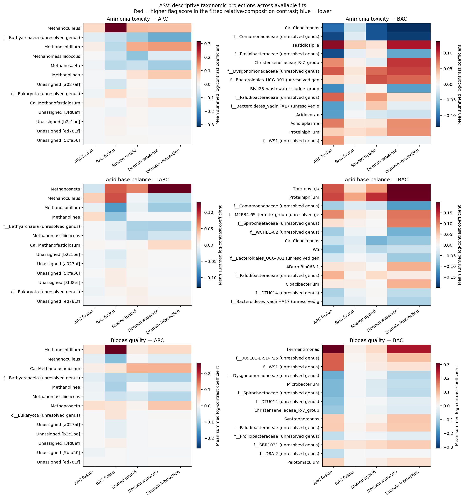
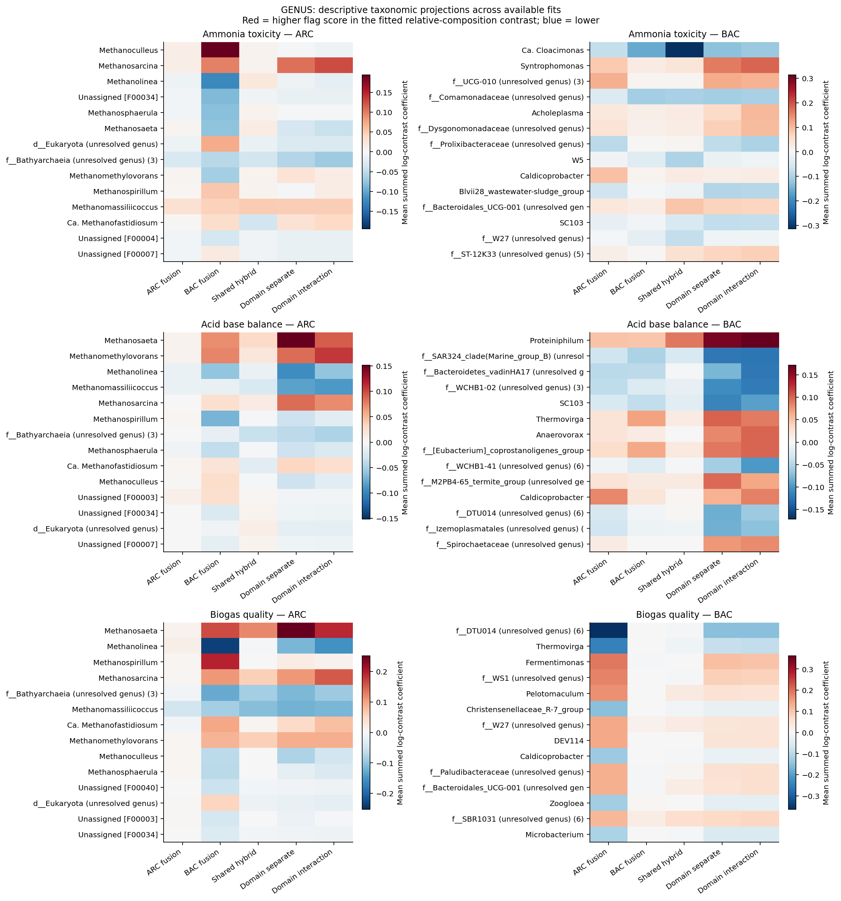
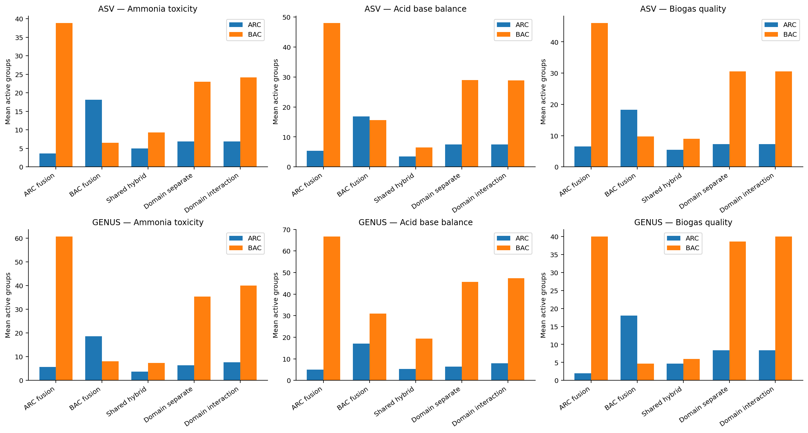
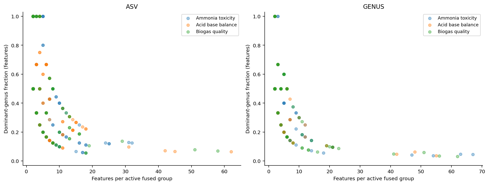

# Experiment 5 — Biological interpretation (stored as exp2)

Analyzed **125 fitted outer models** from **135 planned fits**, across five model families, three flags, and two resolutions. **10 ASV biogas fits are unavailable** because an inner training partition contains only one class. No replacement models or fabricated coefficients are supplied.

## Main findings

1. Fusion yields explicit groups and coefficient directions that can be traced back to ASVs and taxonomy. This supports interpretation of a fitted representation, but a shared coefficient is not evidence of a shared biological function.

2. The selected interaction models contain **0 active ARC–BAC products** across available fits. Inspect the interaction table before making any cross-domain biological claim.

3. Retained features include **2 ASVs assigned to a taxonomic domain different from their assay label**, and **5 without a domain assignment**. These remain in the original models and are explicitly flagged in the interpretation; the models were not silently changed.

4. Curated functional hypotheses are limited to named genera supported by primary literature. Broad Bathyarchaeia, unidentified bacteria and W5 are not automatically assigned a function. Mixed-role groups should be described as predictive aggregates, not functional guilds.

## Concrete observations from the ASV shared hybrid

These examples describe the shared-hybrid fits only; the six detailed reports provide the corresponding results for all five models. They were examined after fitting and are exploratory observations, not prespecified biomarker tests.

**Ammonia:** the Methanomassiliicoccus ASV `ARC::3b768ad6b26d688837b3511e5d2316d2` has a negative coefficient in five of six fits and a positive coefficient in one. Methanosaeta ASVs change sign across fits and differ from one another. The data therefore do not support a single stable genus-wide direction for Methanosaeta, even though its metabolic role is plausible background for an ammonia hypothesis.

**Acid–base balance:** the Proteiniphilum ASV `BAC::14a311b4802d5606cbf72b2dc465ae56` has a positive coefficient in all six fits. This is an interpretable candidate association with the two-sided pH warning, not evidence that Proteiniphilum causes acidification. Low and high pH are combined in this target.

**Biogas quality:** the Candidatus Methanofastidiosum ASV `ARC::abb98aa85e9528ef54e3078ff40ac726` has a positive coefficient in all four available fits. Two planned fits are unavailable; the cohort contains 13 positive samples across only six sites. This is a tentative association with low methane percentage, not evidence that this methanogen reduces methane production.

Shared-hybrid groups and annotation coverage (averaged across available fits; role coverage is the fraction of active feature occurrences covered by this deliberately limited literature curation, not the fraction with a known biological function):

| resolution | target | domain | active_groups_mean | multifeature_genus_purity_mean | active_feature_role_coverage |
| --- | --- | --- | --- | --- | --- |
| asv | warning_acid_base_balance | ARC | 3.500 | 0.555 | 0.477 |
| asv | warning_acid_base_balance | BAC | 6.500 | 0.436 | 0.094 |
| asv | warning_ammonia_toxicity | ARC | 5.000 | 0.512 | 0.496 |
| asv | warning_ammonia_toxicity | BAC | 9.333 | 0.328 | 0.080 |
| asv | warning_biogas_quality | ARC | 5.500 | 0.677 | 0.500 |
| asv | warning_biogas_quality | BAC | 9.000 | 0.272 | 0.063 |
| genus | warning_acid_base_balance | ARC | 5.333 | 0.471 | 0.448 |
| genus | warning_acid_base_balance | BAC | 19.333 | 0.356 | 0.066 |
| genus | warning_ammonia_toxicity | ARC | 3.667 | 0.370 | 0.458 |
| genus | warning_ammonia_toxicity | BAC | 7.333 | 0.379 | 0.058 |
| genus | warning_biogas_quality | ARC | 4.667 | 0.430 | 0.458 |
| genus | warning_biogas_quality | BAC | 6.000 | 0.383 | 0.051 |

## Cohort and provenance

| resolution | target | n_samples | n_sites | n_positive | n_positive_sites |
| --- | --- | --- | --- | --- | --- |
| asv | warning_ammonia_toxicity | 134 | 35 | 24 | 10 |
| asv | warning_acid_base_balance | 134 | 35 | 20 | 12 |
| asv | warning_biogas_quality | 134 | 35 | 13 | 6 |
| genus | warning_ammonia_toxicity | 134 | 37 | 24 | 10 |
| genus | warning_acid_base_balance | 134 | 37 | 20 | 12 |
| genus | warning_biogas_quality | 134 | 37 | 13 | 6 |

The three flags are ammonia toxicity, acid–base balance and biogas quality. Labels are computed from the copied chemistry workbook by the copied fusionML implementation: ammonia uses the project NH4-N/TAN convention (>2.5), acid–base uses pH <6.5 or >8.0, and biogas quality uses CH4 <55%. These are operational warning labels, not direct measurements of microbial activity or experimentally diagnosed inhibition. The two-sided pH flag combines different physiological conditions.

Genus results reuse the existing three-fold, 37-site smoke runs, including all five requested families. ASV results reuse the three hybrid families from Experiment 1 for ammonia and acid–base (36 fits), and add the missing domain-restricted and biogas fits with the same two-repeat, three-outer/two-inner-fold, 35-QC-site protocol. Reused and new outputs are identified in `model_fit_inventory.csv`. The historical genus and ASV results have different protocols; this experiment does not estimate a causal resolution effect or compare them as matched performance benchmarks.

ASV candidate generation and one-standard-error selection match Experiment 1. The interaction family includes an off candidate. The missing ASV runs use the copied fusionML estimator, with model-specific fit caches so domain-restricted graphs are respected. Historical input taxonomy hashes are verified; historical rank mappings were not hashed by the original run manifest, so their current copied versions provide contextual mapping rather than certified historical provenance.

## Model definitions

| Model | Interpretation |
|---|---|
| ARC fusion | Both domains predict; only ARC receives fusion edges. |
| BAC fusion | Both domains predict; only BAC receives fusion edges. |
| Shared hybrid | Both domains fused with a common phylogeny/proportionality mixture. |
| Domain separate | Separate ARC and BAC mixture weights in one joint additive model. |
| Domain interaction | Domain-adaptive main effects plus optional products of centered, standardized ARC/BAC balances. |

## Group interpretation and algebra

For a group G with common coefficient b, its contribution is |G| × b × log(GM(q_G)). The exported `theta` is |G| × b, and small per-taxon residuals are retained in the reconstruction check. This is a geometric-mean log-composition representation; it is not the summed relative abundance of the group. Separate zero-sum constraints make each domain score a relative contrast. `domain_contrasts.csv` gives positive/negative coefficient masses and members for an equivalent weighted geometric-mean ratio, up to the recorded numerical equality residual.

The figures project coefficients onto taxonomy for readable labels. Within each fit, coefficients for features sharing a resolved genus or explicit broader label are summed, then averaged across available fits; absent retained features contribute zero to that projection. Unassigned features retain distinct identifiers, and unrelated uncultured lineages are not merged into one genus. This display can hide opposing ASV coefficients within a genus. Exact feature-level signs and denominators are preserved in `feature_associations.csv`. Sign agreement describes overlapping CV fits; it is not a confidence interval or independent replication.

Taxonomic purity is the largest resolved-genus feature count divided by all features in a group; unknown labels never count as a shared genus, and all-unresolved groups have NA purity. The mean therefore describes groups with at least one resolved genus. Counts refer to model features, not read abundance. ASV membership counts within genus blocks are also unweighted. Patristic-distance ratios compare each multi-feature group with all retained features in the same domain/fit. They are descriptive, not enrichment p-values; phylogenetic compactness is partly imposed by the model and is not independent biological validation.

## Results by flag and resolution

[ASV — Ammonia toxicity](details/asv_warning_ammonia_toxicity.md)

[ASV — Acid base balance](details/asv_warning_acid_base_balance.md)

[ASV — Biogas quality](details/asv_warning_biogas_quality.md)

[GENUS — Ammonia toxicity](details/genus_warning_ammonia_toxicity.md)

[GENUS — Acid base balance](details/genus_warning_acid_base_balance.md)

[GENUS — Biogas quality](details/genus_warning_biogas_quality.md)

## Biological hypotheses supported by external evidence

Methanosaeta and Methanoculleus provide a plausible acetoclastic-versus-hydrogenotrophic axis to examine for ammonia, but the direction must be read from each fitted contrast. In an ammonium perturbation study, active methanogens shifted between these pathways; that study does not establish the response of every ASV here. [Primary ammonium study](https://pmc.ncbi.nlm.nih.gov/articles/PMC8510171/).

Syntrophomonas-associated groups are candidates for studying fatty-acid turnover; stable-isotope-informed digester metagenomics supports this role in particular populations. This does not establish that a fitted group exchanges hydrogen with its apparent ARC counterpart. [Primary isotope study](https://pmc.ncbi.nlm.nih.gov/articles/PMC6687939/).

Proteiniphilum-associated groups warrant investigation of protein degradation and fermentation. Cultured representatives were proteolytic anaerobes from a wastewater reactor; this is a genus-level hypothesis, not evidence of nitrogen flux in these samples. [Primary isolation study](https://pubmed.ncbi.nlm.nih.gov/16280479/).

Bathyarchaeia labels do not identify a uniform methane-producing guild: particular genomes support methane metabolism, while others suggest different substrate use and acetogenic potential. These groups remain functionally unassigned. [Methane-metabolism genomes](https://pubmed.ncbi.nlm.nih.gov/26494757/), [distinct substrate preferences](https://pubmed.ncbi.nlm.nih.gov/26626228/).

All curated genus-to-role entries, evidence levels and primary links are in `functional_evidence.csv`. No gene enrichment, predicted metagenome, functional redundancy test or causal validation has been performed.

## Predictive context and limitations

Prediction metrics are context for how much confidence to place in associations. `prediction_context.csv` reports metrics only for complete out-of-fold repeats; ASV biogas has partial coverage, so its pooled performance is left NA. Low event counts, site/feedstock confounding, relative abundance, assay-domain mismatches and preprocessing thresholds constrain biological conclusions. No significance claims or formal group-stability experiment are made here.

The acid–base flag should be examined separately for low versus high pH in a follow-up before attributing a single biological mechanism. For biogas, more positive independent sites are needed before interpreting an apparent biomarker as reproducible.

Next biological validation should link specific members to independently measured genes/transcripts or targeted activity assays, measure candidate taxa absolutely where feasible, and test the proposed pathway with substrate or isotope experiments. Taxon names alone cannot establish activity.

## Validation and outputs

All 84 source hashes were verified. Every fitted feature maps to copied taxonomy and the supplied resolution-specific tree. Held-out sites are disjoint from training sites. Group-plus-residual reconstruction has maximum error 2.62e-14; domain coefficient sums have maximum residual 3.01e-13. See `validation.json` and `artifact_manifest.json`.

Tables: [group catalog](tables/group_catalog.csv), [exact ASV members and taxonomy](tables/feature_asv_taxonomy.csv), [feature associations](tables/feature_associations.csv), [domain contrasts](tables/domain_contrasts.csv), [interaction status](tables/interaction_summary.csv), [active interaction explanations](tables/active_interactions_annotated.csv), [fit inventory](tables/model_fit_inventory.csv).
